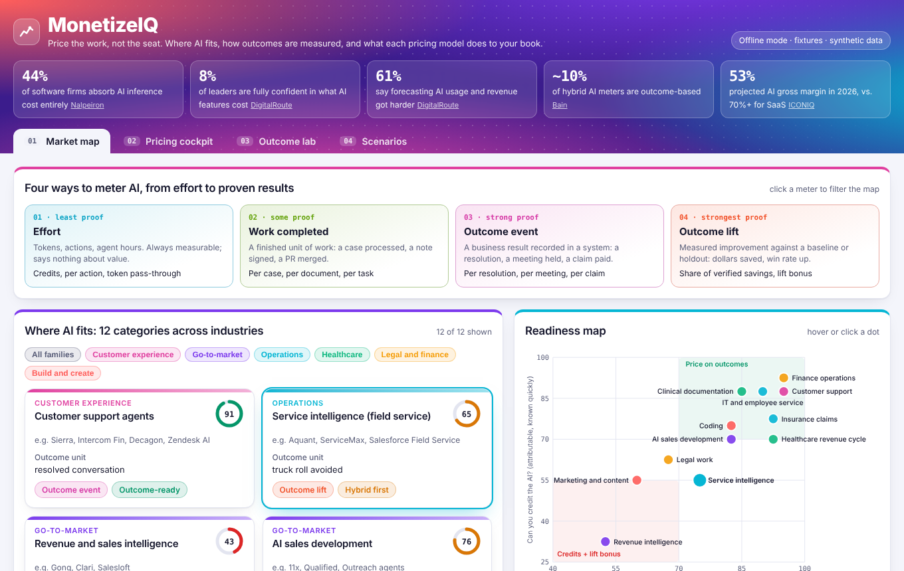
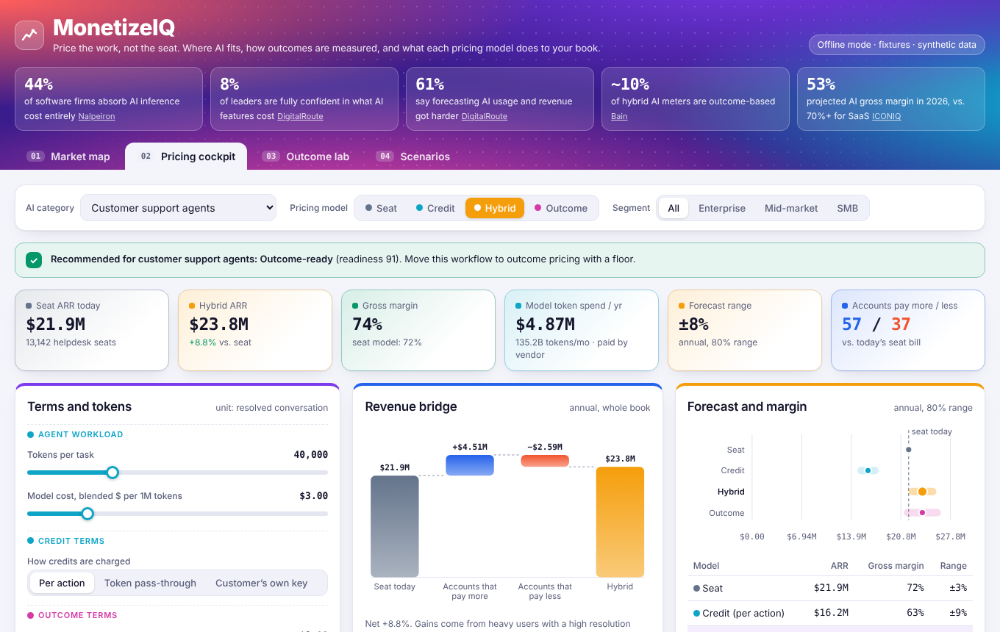
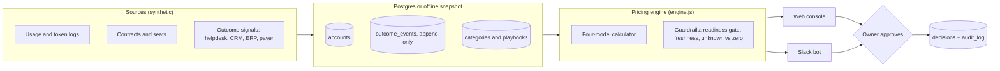

# MonetizeIQ

**Price the work, not the seat.**

MonetizeIQ is a pricing decision cockpit for AI and SaaS companies moving customers from seat pricing to credit, hybrid and outcome pricing. For one book of customers it shows what each model does to revenue, gross margin, AI token cost, forecast confidence and every customer's bill. It also says which workflows are ready for outcome pricing at all, and it refuses to recommend outcome pricing where the result can't be credited to the AI.

It runs as a web console and a Slack bot that share one pricing engine, backed by Postgres or by an offline snapshot of the same data.



> **All data is fictional.** Every company, person and number is synthetic. Defaults are anchored to public 2026 benchmarks, which are linked in the app and below.

- **Live demo (no install):** https://hithakishore-all.github.io/monetizeiq/
- **2-minute captioned walkthrough:** [docs/media/monetizeiq-walkthrough.mp4](docs/media/monetizeiq-walkthrough.mp4)

## Contents

1. [Why this exists](#why-this-exists)
2. [Try it in 2 minutes](#try-it-in-2-minutes)
3. [Ways to run it](#ways-to-run-it)
4. [Using the web console](#using-the-web-console)
5. [Using the Slack bot](#using-the-slack-bot)
6. [The demo records](#the-demo-records)
7. [How it works](#how-it-works)
8. [Beyond the prototype](#beyond-the-prototype)
9. [Full setup](#full-setup)
10. [Configuration reference](#configuration-reference)
11. [HTTP API](#http-api)
12. [Testing](#testing)
13. [Project layout](#project-layout)
14. [Security and data handling](#security-and-data-handling)
15. [Troubleshooting](#troubleshooting)
16. [FAQ and known limitations](#faq-and-known-limitations)
17. [License](#license)

## Why this exists

AI agents do work that seats used to pay for. Vendors are changing pricing faster than they can see the consequences:

| Signal | Number | Source |
| --- | --- | --- |
| Software companies absorbing AI inference cost entirely | 44% (42% pass part of it through as credits or tokens, 13% fully) | [Nalpeiron, n=243, June 2026](https://nalpeiron.com/resources/program/2026-state-of-b2b-software-monetization/ai-inference-cost-handling/) |
| Leaders fully confident in what their AI features cost to deliver | 8% | [DigitalRoute, n=631, 2026](https://info.digitalroute.com/state-of-ai-monetization-2026) |
| Say forecasting AI usage and revenue got harder in the past year | 61% | [DigitalRoute](https://info.digitalroute.com/state-of-ai-monetization-2026) |
| AI product gross margin | 45% in 2025, projected 53% in 2026 | [ICONIQ State of AI 2026](https://www.iconiq.com/growth/insights/state-of-ai-2026) |
| Hybrid AI meters that are outcome-based | About 10% | [Bain, August 2026](https://www.bain.com/it/insights/ai-pricing-a-reality-check-on-effort-usage-and-outcomes/) |

Billing platforms can now meter and invoice any model. The decision of which model each workflow and customer should move to is still made in spreadsheets. **Everyone is building the meter. MonetizeIQ picks the model.**

| Principle | What it means in the product |
| --- | --- |
| Outcomes need proof | Each AI category has an outcome unit, a signal source, a validation rule and an audit trail. |
| Not every workflow is ready | A readiness score (binary result, attributable to the AI, trusted record, known quickly) gates outcome pricing. Below 60, pure outcome is never recommended. |
| Unknown is not zero | Accounts with no outcome signal show "unknown" and are left out of totals. |
| Stale data doesn't get quoted | Recommendations on usage data older than 45 days are withheld. |
| People decide | Only an account's owner can approve. Approving records a decision; it never changes billing. |
| Every number is traceable | Billed outcomes link to a source record, a rule version and an evidence ID. |

## Try it in 2 minutes

You need [Node.js 20 or newer](https://nodejs.org) (22 recommended). No accounts or database.

```bash
git clone https://github.com/hithakishore-all/monetizeiq.git
cd monetizeiq/app
npm ci
npm run offline
```

Open http://127.0.0.1:3000. Start with **Market map**, then open a card in **Scenarios**.

No git? On the repo page choose **Code → Download ZIP**, unzip it, and run the last three commands from the `app` folder.

## Ways to run it

| Mode | Command (in `app/`) | Needs | Use it for |
| --- | --- | --- | --- |
| Offline | `npm run offline` | Node only | Demos, trying it out, tests |
| Offline + Slack | `npm run offline` with Slack tokens in `app/.env` | A Slack workspace where you can install apps | Showing the Slack flow without a database |
| Live | `npm run db:setup` once, then `npm start` | Postgres 14+ | The real store: decisions and audit rows persist |

Offline mode uses `app/fixtures/snapshot.json`, which is generated from the same source as the database seed, so both modes show the same accounts and numbers. In offline mode, decisions and the audit log reset when you stop the server.

## Using the web console

| Tab | What you do there |
| --- | --- |
| **Market map** | See the four ways to meter AI (effort, work completed, outcome event, outcome lift) and 12 AI categories across industries. Click a category for its outcome unit, formula, metrics, signal source, validation rule, audit trail, market pricing today and recommended path. The readiness map plots every category by "can you measure it" and "can you credit the AI". |
| **Pricing cockpit** | Pick a category and a pricing model. Move the sliders for tokens per task, model price, credit terms (per action, token pass-through, customer's own key), price per outcome, success rate, verification window, hybrid fee and cap. Read the KPI tiles, revenue bridge, forecast range, token-economics curve and book heatmap. Click a square in the heatmap to open that account. |
| **Account panel** (bottom of the cockpit) | The recommendation with its guardrails, an **Acting as** picker and **Approve Seat / Credit / Hybrid / Outcome** buttons, the monthly bill under each model, the outcome funnel, a renewal talk track and the audit trail of stored outcome events (**Copy as CSV**). |
| **Outcome lab** | Turn what the AI changes into dollars (for example fewer parts per job and fewer avoidable dispatches in service intelligence), set how much is credited to the AI and the vendor's share, and see value created, the vendor fee, what the customer keeps, and the evidence an invoice needs. |
| **Scenarios** | Ten demo records, one click each. Each opens the cockpit on the account that proves one behavior. |

**Ask the pane** in the cockpit answers what-if questions ("What if token prices drop 50%?", "Which accounts pay less?") from the same engine. Answers are rule-based, not a live model, and many offer **Apply to the pane**.



## Using the Slack bot

| Command | What you get |
| --- | --- |
| `/monetize <account name>` | The account's recommendation, guardrails, monthly bill under each model and an **Approve** button. Try `/monetize Ulvane Home`. |
| `/monetize ready` | AI categories ranked by outcome readiness. |
| `/monetize help` | The commands. |
| `@MonetizeIQ <account name>` | The same answer, in a thread. |

**Owner rule.** The Approve button works only for Slack users mapped to the account's owner in `SLACK_APPROVERS` (for example `U01ABC=riley`). Anyone else gets a private "you can't approve" message, and the refusal is written to the audit log. Approving records a decision. It never changes billing and never messages a customer. Withheld recommendations (stale or missing data) show no Approve button.

Setup takes about 10 minutes: [docs/SETUP_SLACK.md](docs/SETUP_SLACK.md).

## The demo records

| # | Account | Category | What it demonstrates |
| --- | --- | --- | --- |
| 1 | Ulvane Home | Customer support | Hero run: outcome pricing lifts revenue and margin; every billed outcome traces to a helpdesk record |
| 2 | Corvane Outfitters | Customer support | Renewal risk caught: a light adopter would pay 76% less under pure outcome, so the recommendation is a hybrid floor |
| 3 | Halvero Software | Revenue intelligence | The product says no: readiness 43, so pure outcome is blocked and credits plus a lift bonus are recommended |
| 4 | Kestane Distribution | Finance operations | Pass-through trap: halve model prices and pass-through credit revenue falls about 40% |
| 5 | Wexmoor Cloud | AI sales development | Dispute-heavy window: a 2-day acceptance window triples disputes |
| 6 | Norvane Health System | Healthcare revenue cycle | Clean run: outcome-ready, priced at about 4% of recovered dollars |
| 7 | Pellwyn Realty | Legal | Customer's own model key: the vendor bills a platform fee; the model bill shows separately |
| 8 | Estrova Fiber | Service intelligence | Stale data: usage is 52 days old, so the recommendation is withheld |
| 9 | Delmora Pharma | IT and employee service | Missing data: no outcome signal, so outcome revenue is unknown, not $0, and is excluded from totals |
| 10 | Tarrow Payments | Revenue intelligence | Token exposure: 600k tokens per task; per-action credit margin turns negative near $10 per 1M tokens |

## How it works



| Stage | Reads | Produces | Guardrail |
| --- | --- | --- | --- |
| Data generator (`data/generate_data.py`) | `data/catalog.json` | Accounts, outcome events, SQL seed, offline snapshot | Deterministic; fictional names and `.example` emails only |
| Store (`app/src/stores/`) | Postgres views `v_account_book`, `v_outcome_evidence`, or the snapshot | Normalized accounts and events | App role is read-only except for decisions and the audit log |
| Engine (`app/public/engine.js`) | An account, its category, scenario parameters | Revenue, cost, margin and funnel under each model; book totals; forecast ranges | Missing signal returns `null`, never 0 |
| Recommender (`recommend` in the engine) | Engine output and readiness | One model with a reason, or "withheld" | Readiness gate (60), freshness limit (45 days), light-adopter hybrid floor |
| Approval (`app/src/service.js`) | Recommendation, owner list | A decision row and audit entries | Owner only; refuses withheld and gate-blocked choices; idempotent |

More detail, including the data model and event catalog: [docs/ARCHITECTURE.md](docs/ARCHITECTURE.md).

## Beyond the prototype

The engine and API are deliberately front-end agnostic. Other ways to put them in front of people:

- **Claude via MCP:** expose `/api/book`, `/api/accounts/:id/recommendation` and `/api/decisions` as MCP tools so a pricing analyst can ask in plain language.
- **A billing platform handoff:** export approved decisions as price-change files for Stripe Billing, Orb, Chargebee or Zuora.
- **CRM panel:** show the recommendation and talk track on the account page in Salesforce or HubSpot.
- **BI and notebooks:** point Hex, Mode or a Streamlit app at the governed views.
- **A live model for Ask the pane:** swap the rule-based answers for a model that calls the same API, keeping every number engine-computed.
- **Real usage data:** replace the generator with an importer for usage and outcome events from a billing or product-analytics export.

## Full setup

| Guide | What it covers |
| --- | --- |
| [docs/SETUP_POSTGRES.md](docs/SETUP_POSTGRES.md) | Create the database, run `npm run db:setup`, give the app role a password, start live mode |
| [docs/SETUP_SLACK.md](docs/SETUP_SLACK.md) | Create the Slack app from `app/slack-manifest.yml`, install it, add tokens and approvers |
| [docs/ARCHITECTURE.md](docs/ARCHITECTURE.md) | Components, data model, views, evidence IDs, states, API shapes, security model, design decisions |
| [docs/TROUBLESHOOTING.md](docs/TROUBLESHOOTING.md) | Symptom, cause and fix tables for Node, Postgres, Slack and the console |

## Configuration reference

Settings live in `app/.env` (copy `app/.env.example`). Environment variables win over the file.

| Setting | Default | Meaning |
| --- | --- | --- |
| `DATABASE_URL` | none | Postgres connection for the app role. Required in live mode. |
| `DATABASE_ADMIN_URL` | falls back to `DATABASE_URL` | A role that can create schemas and roles. Used only by `npm run db:setup`. |
| `MONETIZEIQ_HOST` | `127.0.0.1` | Address the web console binds to. Use `0.0.0.0` only to allow other machines. |
| `MONETIZEIQ_PORT` (or `PORT`) | `3000` | Web console port. `--port=NNNN` on the command line overrides it. |
| `MONETIZEIQ_MODE` | live | Set to `offline` to use the snapshot without `--offline`. |
| `SLACK_BOT_TOKEN` | none | Bot token, starts with `xoxb-`. |
| `SLACK_APP_TOKEN` | none | App-level token with `connections:write`, starts with `xapp-`. |
| `SLACK_APPROVERS` | none | Slack user IDs mapped to owners who may approve, e.g. `U01ABC=riley,U02DEF=jordan`. |

Database settings, in `monetizeiq.app_config`: `demo_today` (the pinned date freshness is measured from, `2026-11-18`), `catalog_version` and `catalog_meta`. Pricing settings in `data/catalog.json` → `pricing`: `creditPerAction` ($0.10), `byokPerAction` ($0.03), `defaultTokenPrice` ($3 per 1M tokens), `staleDays` (45), `readinessGate` (60).

## HTTP API

All responses are JSON. Errors return `{ "error": "<code>", "message": "<what to do>" }` with a 4xx status for bad input.

| Method and path | Returns |
| --- | --- |
| `GET /api/health` | `ok`, version, mode (`offline` or `live`), whether Slack is connected, the pinned demo date |
| `GET /api/catalog` | Categories with playbooks and lab defaults, meters, families, scenarios, pricing settings |
| `GET /api/owners` | Account owners (fictional) |
| `GET /api/accounts?category=<id>` | Accounts, all or one category |
| `GET /api/accounts/:id` | Account, owner, profile, monthly bills by model, recommendation |
| `GET /api/accounts/:id/events` | Stored outcome events, newest first, with evidence IDs |
| `GET /api/accounts/:id/recommendation` | Recommendation (also writes an audit entry) |
| `GET /api/book/:category` | Annual revenue, gross margin and forecast range per model. Query parameters: `cmode`, `markup`, `tokp`, `ktokMult`, `price`, `shift`, `win`, `fee`, `cap` |
| `GET /api/readiness` | Categories ranked by outcome readiness |
| `POST /api/decisions` | Body `{ accountId, model, approverId, idempotencyKey? }`. 201 created, 200 repeat, 403 not the owner, 409 withheld or blocked by the readiness gate |
| `GET /api/decisions` | Recent decisions |
| `GET /api/audit` | Recent audit entries |

## Testing

```bash
cd app
npm test
```

`npm test` starts the real server in offline mode on a free port and walks the whole workflow through the API: health, catalog, accounts, book math (including the pass-through margin identity), every guardrail scenario, owner-only and idempotent approvals, audit entries, bad-input errors, the Slack message format and the configuration checks. 14 tests.

Regenerate the data and confirm it is byte-identical: `python3 data/generate_data.py` (run twice and compare). Re-record the walkthrough video after UI changes: `cd app && make video`.

## Project layout

```
monetizeiq/
├── README.md, LICENSE, SECURITY.md, CONTRIBUTING.md, CHANGELOG.md
├── data/
│   ├── catalog.json            source of truth: 12 categories, playbooks, scenarios, pricing settings
│   ├── generate_data.py        builds every seed file below
│   └── seed/                   accounts.csv, outcome_events.csv
├── db/
│   ├── 01_setup.sql            schema and the least-privilege app role
│   ├── 02_tables.sql           tables
│   ├── 03_views.sql            governed views
│   ├── 04_seed.sql             generated seed data
│   └── 05_grants.sql           app role grants
├── app/
│   ├── package.json, package-lock.json, .env.example, slack-manifest.yml, Makefile
│   ├── fixtures/snapshot.json  generated offline data
│   ├── public/                 web console (index.html) and the shared engine (engine.js)
│   ├── src/                    index.js, config.js, server.js, service.js, slack.js, stores/
│   ├── scripts/                db-setup.js, video/ (walkthrough recorder)
│   └── test/smoke.test.js
└── docs/
    ├── SETUP_POSTGRES.md, SETUP_SLACK.md, ARCHITECTURE.md, TROUBLESHOOTING.md
    ├── screenshots/
    └── media/                  walkthrough video, poster, chapters.json
```

## Security and data handling

- All data is synthetic. Emails use the reserved `.example` domain.
- No secrets live in the repo. `app/.env` is git-ignored; you paste tokens into it yourself.
- The app's database role (`monetizeiq_app`) can read the catalog and governed views and can only insert decisions and audit rows. It cannot change accounts or outcome events.
- Outcome events are append-only; a dispute is a new line, not an edit.
- The web console binds to `127.0.0.1` by default.
- The Slack bot uses Socket Mode, so there is no public URL to secure. Approvals are limited to mapped owners.
- More in [SECURITY.md](SECURITY.md).

## Troubleshooting

| Symptom | Fix |
| --- | --- |
| `Live mode needs DATABASE_URL` | Run `npm run offline`, or follow [docs/SETUP_POSTGRES.md](docs/SETUP_POSTGRES.md) step 4. |
| `EADDRINUSE` | Port 3000 is taken. Run `npm run offline -- --port=3100`. |
| Console says it can't load data | The server isn't running, or you opened `index.html` as a file. Open the URL the server prints. |
| `Slack bot is off` | Expected without tokens. To turn it on, follow [docs/SETUP_SLACK.md](docs/SETUP_SLACK.md). |
| `/monetize` says "dispatch_failed" | The server isn't running or the app token is wrong. |

Full tables: [docs/TROUBLESHOOTING.md](docs/TROUBLESHOOTING.md).

## FAQ and known limitations

- **Is any of this real customer data?** No. Every company, person and number is fictional.
- **Does approving change a price?** No. It records a decision and an audit entry for a billing platform to pick up.
- **Is Ask the pane an AI model?** No. It is rule-based over the same engine, so every number is computed, not generated.
- **Why isn't Salesforce included?** The source of record here is Postgres. A CRM panel is listed under [Beyond the prototype](#beyond-the-prototype).
- **Limitations:** forecast ranges are a simple volume and success-rate variability model; outcome events are a recent sample per account, not a full ledger; the web console recomputes book totals in the browser for interactivity, while the API recomputes them on the server with the same engine file.

## License

[Apache License 2.0](LICENSE).
