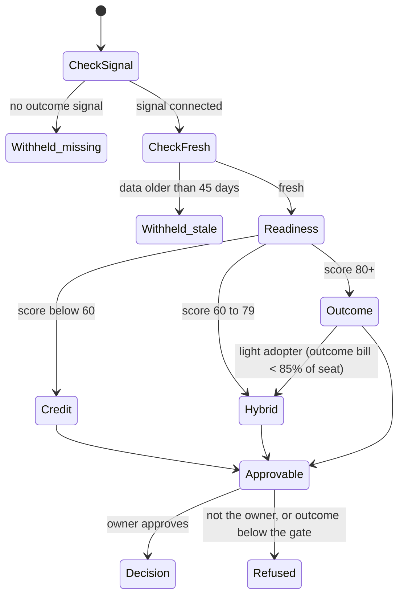

# Architecture

## Components

| Component | File(s) | Role |
| --- | --- | --- |
| Catalog | `data/catalog.json` | Source of truth: 12 AI categories (playbook, pricing defaults, lab drivers), 4 meters, 6 families, 10 scenarios, pricing settings |
| Data generator | `data/generate_data.py` | Deterministically builds accounts and outcome events, the SQL seed and the offline snapshot |
| Database | `db/01_setup.sql` … `db/05_grants.sql` | Schema, tables, governed views, seed, least-privilege grants |
| Stores | `app/src/stores/offline.js`, `postgres.js`, `common.js` | Two interchangeable stores with one interface; both return the same shapes |
| Engine | `app/public/engine.js` | Pricing math and guardrails, loaded by Node and by the browser |
| Service | `app/src/service.js` | Business rules shared by the API and Slack: parameter validation, recommendations, owner-only approval |
| Web server | `app/src/server.js`, `app/src/index.js` | Express API and static console; configuration checks; clean shutdown |
| Slack bot | `app/src/slack.js`, `app/slack-manifest.yml` | Bolt in Socket Mode: `/monetize`, mentions, Approve button |
| Console | `app/public/index.html` | Market map, pricing cockpit, outcome lab, scenarios |
| Recorder | `app/scripts/video/` | Playwright + Chrome screencast walkthrough recorder |

## Data model

| Table | Key columns | Notes |
| --- | --- | --- |
| `app_config` | `key`, `value` | `demo_today` pins the date freshness is measured from; `catalog_meta` holds meters, families, scenarios, pricing and category order |
| `categories` | `id`, `name`, `family`, `meter`, `definition` (jsonb) | `meter` is one of `effort`, `output`, `event`, `lift` |
| `owners` | `id`, `name`, `email`, `role` | Fictional; `.example` emails |
| `accounts` | `id`, `category_id`, `segment`, `seats`, `tasks_per_month`, `success_rate`, `usage_as_of`, `owner_id`, `data_flag`, `scenario` | `data_flag` is `stale`, `missing` or null |
| `outcome_events` | `event_id`, `account_id`, `source_record`, `occurred_at`, `tokens`, `cost_to_serve`, `status`, `reason`, `rule_version`, `billed`, `evidence_id` | Append-only |
| `decisions` | `id`, `idempotency_key` (unique), `account_id`, `model`, `approver_id`, `inputs` (jsonb) | Written only by an owner's approval |
| `audit_log` | `id`, `at`, `actor`, `action`, `account_id`, `detail` (jsonb) | Every recommendation shown or withheld, refusal and decision |

### Governed views

`v_account_book`: every account column plus `owner_name`, `owner_email` and `data_age_days` (demo date minus `usage_as_of`).

`v_outcome_evidence`: every outcome event with `account_name`, so each billed line carries a source record, a date, a rule version and an evidence ID.

The app role reads only these views plus `app_config`, `categories` and `owners`.

### Evidence ID patterns

| Category | Source record | Evidence ID |
| --- | --- | --- |
| Customer support | `HD-######` | `HD-EV-######` |
| Service intelligence | `WO-######` | `WO-EV-######` |
| Revenue intelligence | `OPP-######` | `OPP-EV-######` |
| AI sales development | `MTG-######` | `MTG-EV-######` |
| IT and employee service | `INC-######` | `INC-EV-######` |
| Insurance claims | `CLA-######` | `CLA-EV-######` |
| Healthcare revenue cycle | `CLM-######` | `CLM-EV-######` |
| Clinical documentation | `ENC-######` | `ENC-EV-######` |
| Legal | `CTR-######` | `CTR-EV-######` |
| Finance operations | `INV-######` | `INV-EV-######` |
| Software engineering | `PR-######` | `PR-EV-######` |
| Marketing | `AST-######` | `AST-EV-######` |

Rule versions read `<prefix>-rule v1.<window days>`, e.g. `hd-rule v1.7`.

## Pricing engine

For an account with `att` tasks a month at success rate `s`:

- succeeded = att × s; excluded = succeeded × exclusion rate × (1 − e^(−window/τ)); disputed = verified × dispute rate × e^(−window/τ); billable = verified − disputed
- cost to serve = att × (tokens per task × model price + infrastructure cost per task)
- **Seat** = seats × seat price
- **Credit, per action** = att × actions per task × $0.10; **pass-through** = cost to serve × (1 + markup); **customer's own key** = att × actions × $0.03, and the vendor's cost excludes model tokens
- **Outcome** = billable × price per outcome (null when the outcome signal is missing)
- **Hybrid** = min(max(outcome, fee), max(fee, seat × cap)), fee = seat × fee %
- Forecast range (80%) = ±1.28 × CV, where CV combines task-volume and success-rate variability

## Recommendation states



## Recommendation JSON

```json
{
  "accountId": "support-001",
  "readiness": 91,
  "path": "Outcome-ready",
  "bills": { "seat": 123849, "credit": 106028.8, "hybrid": 170360.56, "outcome": 170360.56 },
  "status": "ok",
  "code": "recommended",
  "model": "outcome",
  "reason": "Move this workflow to outcome pricing with a floor.",
  "delta": 0.3756,
  "gateBlocksOutcome": false
}
```

Withheld recommendations have `status: "withheld"`, `model: null` and `code` of `stale_data` or `missing_signal`.

## Event catalog (audit_log.action)

| Action | Written when | Detail |
| --- | --- | --- |
| `recommendation_shown` | A recommendation is requested from the API or Slack | `model`, `code` |
| `recommendation_withheld` | Same, but stale or missing data | `code` |
| `approval_refused` | Not the owner, withheld, or outcome blocked by the gate | `reason`, `model` |
| `decision_recorded` | An owner approves for the first time with that key | `model`, `decisionId` |

## Security model

- Two Postgres roles: an admin role used only by `npm run db:setup`, and `monetizeiq_app` for the running app (read views and catalog; insert decisions and audit only).
- Secrets come only from `app/.env` or the environment; none are committed.
- The web console binds to `127.0.0.1` unless `MONETIZEIQ_HOST` says otherwise.
- Slack: Socket Mode (no inbound URL); approvals limited to `SLACK_APPROVERS`.
- Request bodies are capped at 20 KB; bad input returns 400, unknown records 404, refusals 403 or 409.

## Design decisions

| Decision | Why |
| --- | --- |
| One engine file for Node and the browser | Every number in the console, the API and Slack comes from the same code. |
| Offline and live stores with one interface | The demo runs anywhere; tests use the real server without a database. |
| Generated seed for both stores | Offline and live show identical data; the generator is deterministic. |
| Readiness gate in the engine, enforced again at approval | A UI bug can't approve a blocked choice. |
| Missing signal is `null`, not 0 | A missing integration must never read as a customer who pays nothing. |
| Approvals record decisions only | Pricing changes belong in a billing platform with its own controls. |
| Pinned demo date | Freshness checks and screenshots stay reproducible. |
